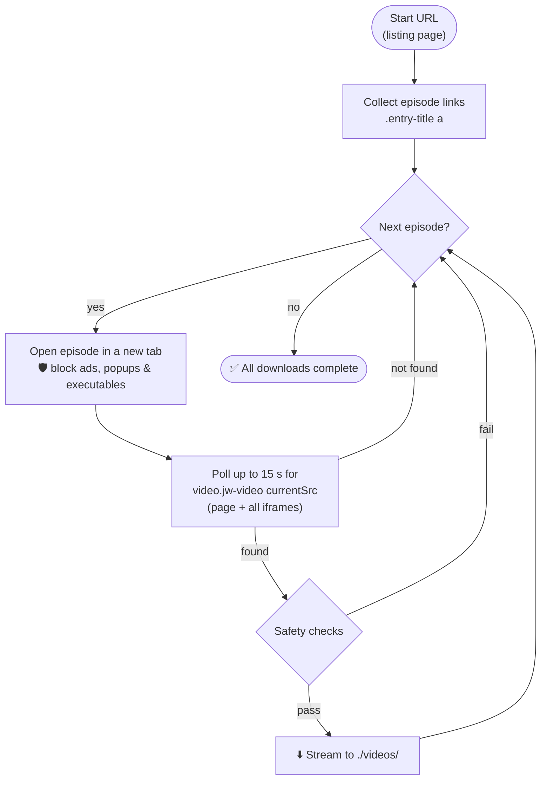

<div align="center">

# 🎬 Bulk Videos Scraper

**A Puppeteer script that walks a video listing page, opens every episode, finds the real video source behind the player and downloads it — with ad-blocking and safety checks built in.**


[How it works](#%EF%B8%8F-how-it-works) · [Safety](#%EF%B8%8F-safety-checks) · [Usage](#-usage) · [Configuration](#-configuration)

</div>

---

## ⚙️ How it works



## ✨ Features

- 🔗 **Auto-discovers episodes** from a listing page
- 🎯 **Finds the real stream** inside JW Player — even when it's nested in an iframe
- 🛡️ **Request interception** aborts ads, trackers, pop-ups and executable downloads
- 📥 **Streams files to disk** (no full-file buffering in memory)
- 📟 **Clear console progress** — `[3/24] Visiting …`, `✅ Saved → file.mp4`

## 🛡️ Safety checks

Before anything is written to disk, each download must pass **all** of these:

| Check | Rule |
|---|---|
| Extension allow-list | Only `.mp4`, `.webm`, `.mkv` |
| Extension block-list | Rejects `.apk`, `.exe`, `.msi`, `.zip`, `.rar`, `.7z`, `.html`, `.js`, `.php`, `.bat` |
| No redirects | Any `3xx` response is refused |
| Content-Type | Must start with `video/` |

## 🚀 Usage

```bash
git clone https://github.com/Shariq2003/Bulk-Videos-Scraper.git
cd Bulk-Videos-Scraper
npm install          # installs Puppeteer (+ its Chrome), node-fetch, fs-extra
node script.js
```

Downloaded files land in **`./videos/`**. The browser runs **non-headless** so you can watch it work; set `headless: true` in `script.js` to hide it.

## 🔧 Configuration

<details>
<summary><b>Tweak the constants at the top of <code>script.js</code></b></summary>

| Constant | Purpose |
|---|---|
| `START_URL` | Listing page that contains the episode links |
| `OUTPUT_DIR` | Where videos are saved (default `./videos`) |
| `ALLOWED_EXTENSIONS` | File types you accept |
| `BLOCKED_EXTENSIONS` | File types that are always rejected |

To target a different site, also update the selectors `.entry-title a` (episode links) and `video.jw-video` (player element).

</details>

> [!IMPORTANT]
> Only download content you have the right to download, and respect each website's terms of service.

---

<div align="center">

Built by **[Shariq](https://github.com/Shariq2003)** · [LinkedIn](https://www.linkedin.com/in/shariq-sd)

⭐ If you found this useful, consider giving it a star!

</div>
